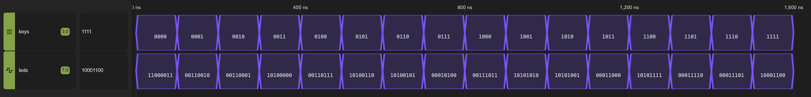
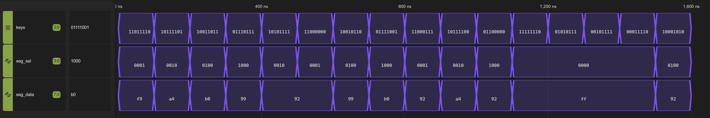
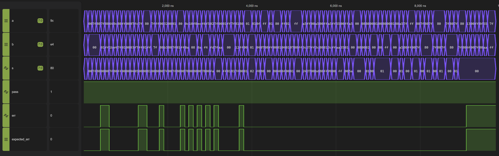

# Lab3 Report

## Task-1

### Modules Design

Code:

```verilog
module Lab3_Led_Key(
    input [3:0] keys,
    output [7:0] leds
  );

  assign leds[1:0] = ~keys[1:0];
  assign leds[3:2] = keys[3:2];

  reg [2:0] nums = 3'b000;

  assign leds[6:4] = nums;
  assign leds[7] = ~(nums & 1);

  always @(*) begin
    nums = ~keys[0] + ~keys[1] + ~keys[2] + ~keys[3];
  end

endmodule
```

Ideas:

1. 对于 `LED[1:0]`，题目要求当第 i 个按键（i = 0 或 1）被按下时，对应的 `LED[i]` 点亮（ON）；否则熄灭（OFF）。由于按下时 `keys[i]` 实际为 0，故**取反**后赋值给 `LED[i]`：`assign leds[1:0] = ~keys[1:0];`。
2. 对于 `LED[3:2]`，题目要求当第 i 个按键（i = 2 或 3）被按下时，对应的 `LED[i]` 熄灭（OFF）；否则点亮（ON）。由于按下时 `keys[i]` 实际为 0，故**直接**赋值给 `LED[i]`：`assign leds[3:2] = keys[3:2];`。
3. 对于 `LED[6:4]`，题目要求以3位二进制数（b000～b111）显示当前被按下的按键数量（范围：0～4）。首先定义一个 `nums` 记录 `keys` 为 0 的个数（也就是被按下的按键的数量）。`LED[6:4]` 赋值为 `nums`。在 `always` 语块中每次更新 `nums`：
```verilog
  always @(*) begin
    nums = ~keys[0] + ~keys[1] + ~keys[2] + ~keys[3];
  end
```
4. 对于 `LED[7]`，题目要求指示当前被按下按键数量的奇偶性：若数量为偶数（包括0），则 `LED[7]` 点亮（ON）；否则熄灭（OFF）。使用 `~(nums & 1)` 判断是否为偶数，由于偶数的二进制末尾一定为 0，故 `nums` 与 1 **按位与**后取反即可，之后赋值给 `LED[7]`：`assign leds[7] = ~(nums & 1);`。

### Testbench

Code:

```verilog
`timescale 1ns/1ps
module tb_Lab3_Led_Key ();

  reg [3:0]  keys;
  wire [7:0] leds;

  Lab3_Led_Key uut (.keys(keys), .leds(leds));

  reg [4:0] i;

  initial begin
    for (i = 0; i < 16; i = i + 1) begin
      keys = i;
      #100;
    end
    $finish;
  end

  initial begin
    $dumpfile("tb_Lab3_Led_Key.vcd");
    $dumpvars;
    $display("save to tb_Lab3_Led_Key.vcd");
  end

endmodule
```

Ideas:

由于输入情况只有 16 种（`keys` 是 4 位二进制输入），故直接枚举 `keys`，这里使用 `for` 循环批量生成：
```verilog
    for (i = 0; i < 16; i = i + 1) begin
      keys = i;
      #100;
    end
```

### Verification results

Waveform:



Description:

1. Test Case 1 — `KEY = 0000`：4 个按键按下，`LED[3:0] = 0011`，`LED[6:4] = 100`（4），`LED[7] = 1`（偶数）。输出 11000011。
2. Test Case 2 — `KEY = 0001`：3 个按键按下，`LED[3:0] = 0010`，`LED[6:4] = 011`（3），`LED[7] = 0`（奇数）。输出 00110010。
3. Test Case 3 — `KEY = 0010`：3 个按键按下，`LED[3:0] = 0001`，`LED[6:4] = 011`（3），`LED[7] = 0`（奇数）。输出 00110001。
4. Test Case 4 — `KEY = 0011`：2 个按键按下，`LED[3:0] = 0000`，`LED[6:4] = 010`（2），`LED[7] = 1`（偶数）。输出 10100000。
5. Test Case 5 — `KEY = 0100`：3 个按键按下，`LED[3:0] = 0111`，`LED[6:4] = 011`（3），`LED[7] = 0`（奇数）。输出 00110111。
6. Test Case 6 — `KEY = 0101`：2 个按键按下，`LED[3:0] = 0110`，`LED[6:4] = 010`（2），`LED[7] = 1`（偶数）。输出 10100110。
7. Test Case 7 — `KEY = 0110`：2 个按键按下，`LED[3:0] = 0101`，`LED[6:4] = 010`（2），`LED[7] = 1`（偶数）。输出 10100101。
8. Test Case 8 — `KEY = 0111`：1 个按键按下，`LED[3:0] = 0100`，`LED[6:4] = 001`（1），`LED[7] = 0`（奇数）。输出 00010100。
9. Test Case 9 — `KEY = 1000`：3 个按键按下，`LED[3:0] = 1011`，`LED[6:4] = 011`（3），`LED[7] = 0`（奇数）。输出 00111011。
10. Test Case 10 — `KEY = 1001`：2 个按键按下，`LED[3:0] = 1010`，`LED[6:4] = 010`（2），`LED[7] = 1`（偶数）。输出 10101010。
11. Test Case 11 — `KEY = 1010`：2 个按键按下，`LED[3:0] = 1001`，`LED[6:4] = 010`（2），`LED[7] = 1`（偶数）。输出 10101001。
12. Test Case 12 — `KEY = 1011`：1 个按键按下，`LED[3:0] = 1000`，`LED[6:4] = 001`（1），`LED[7] = 0`（奇数）。输出 00011000。
13. Test Case 13 — `KEY = 1100`：2 个按键按下，`LED[3:0] = 1111`，`LED[6:4] = 010`（2），`LED[7] = 1`（偶数）。输出 10101111。
14. Test Case 14 — `KEY = 1101`：1 个按键按下，`LED[3:0] = 1110`，`LED[6:4] = 001`（1），`LED[7] = 0`（奇数）。输出 00011110。
15. Test Case 15 — `KEY = 1110`：1 个按键按下，`LED[3:0] = 1101`，`LED[6:4] = 001`（1），`LED[7] = 0`（奇数）。输出 00011101。
16. Test Case 16 — `KEY = 1111`：0 个按键按下，`LED[3:0] = 1100`，`LED[6:4] = 000`（0），`LED[7] = 1`（偶数）。输出 10001100。

通过上述计算检验后结果完全一致，正确。

## Task-2

### Modules Design

Code:

```verilog
module Lab3_Seg_Key(
    input [7:0] keys,
    output [3:0] seg_sel,
    output [7:0] seg_data
  );

  reg [4:0] key1;
  reg [2:0] key2;
  reg [3:0] idx;
  reg [7:0] num;

  assign seg_sel = idx;
  assign seg_data = ~num;

  always @(*) begin
    key1 = ~keys;
    key2 = ~(keys >> 5);

    if (key2 >= 1 && key2 <= 4) idx = 4'b0001 << (key2 - 1);
    else idx = 4'b0000;

    if (idx && (key1 & 5'b10000)) num = 8'b01101101;
    else if (idx && (key1 & 5'b01000)) num = 8'b01100110;
    else if (idx && (key1 & 5'b00100)) num = 8'b01001111;
    else if (idx && (key1 & 5'b00010)) num = 8'b01011011;
    else if (idx && (key1 & 5'b00001)) num = 8'b00000110;
    else num = 8'b00000000;
  end

endmodule
```

Ideas:

首先对于 `seg_sel` 和 `seg_data` 是 `wire` 类型，使用 `idx` 和 `num` 的 `reg` 类型去作为变量，最终连接到它们。

`seg_sel` 是**高电位有效**，所以直接接取 `idx`；`seg_data` 是**低电位有效**，所以对 `num` 取反后接取。

使用 `key1` 和 `key2` 分别接输入信号的两部分，由于按键是反向的所以截取后**取反**。这里由于限定了 `key1` 和 `key2` 的位宽，所以在取 `keys` 或者 `keys >> 5` 的时候会自动抛去高位的值（我只需要低位）。

`idx` 作为决定哪一个数位亮的位置索引，由 `key2` 决定。当 `key2` 超出范围（1~4）时将 `idx` 置零（`if` 分支判断），同时下面的 `num` 计算也会走到最终的 `else` 分支，`num` 也被置零。

`key2` 到 `idx` 的转换实际上是一个 *2-to-4 decoder*，这里使用的是利用**位运算**的一个最简单的实现：`idx = 4'b0001 << (key2 - 1);`。由于 `key2` 是 1~4，故先减一再参与位移。

下面计算 `num` 的时候，采用连续嵌套式的 `if-else` 保证优先级：5->4->3->2->1->无效。每一次只需要检测 `key1` 在这一位上是否有值即可，也就是使用**按位与**来实现，例如：`if (idx && (key1 & 5'b10000)) num = 8'b01101101;`。当所有五个位置都是空的时候，再 fallback 到全零。`num` 的具体填值根据 PPT 中给定的表格参考填入，由高位到低位分别是：dp、g、f、e、d、c、b、a。最后需要注意的是，`num` 最后需要**取反**交给 `seg_data`。

### Testbench

Code:

```verilog
`timescale 1ns/1ps

module tb_Lab3_Seg_Key();
  reg [7:0]  keys;
  wire [3:0] seg_sel;
  wire [7:0] seg_data;

  Lab3_Seg_Key uut (.keys(keys), .seg_sel(seg_sel), .seg_data(seg_data));

  initial begin
    keys = 8'b110_11110; #100;
    keys = 8'b101_11101; #100;
    keys = 8'b100_11011; #100;
    keys = 8'b011_10111; #100;
    keys = 8'b101_01111; #100;
    keys = 8'b110_00000; #100;
    keys = 8'b100_10110; #100;
    keys = 8'b011_11001; #100;
    keys = 8'b110_00111; #100;
    keys = 8'b101_11100; #100;
    keys = 8'b011_00000; #100;
    keys = 8'b111_11110; #100;
    keys = 8'b010_10111; #100;
    keys = 8'b001_01111; #100;
    keys = 8'b000_11110; #100;
    keys = 8'b100_01010; #100;
  end
  
  initial begin
    $dumpfile("tb_Lab3_Seg_Key.vcd");
    $dumpvars;
    $display("save to tb_Lab3_Seg_Key.vcd");
  end

endmodule
```

Ideas:

设计了 16 组测试样例，主要测试以下四种情况：
1. 单键输入（Test 1~5）：验证 KEY0～KEY4 分别控制数字 1～5 的显示，以及四个数码管的位选功能。
2. 多键同时输入（Test 6~11）：验证优先级编码器能否正确选择编号最大的按键。
3. 无效位选输入（Test 12~15）：验证第二组按键对应的数值为 0 或 5～7 时，所有数码管均不点亮。
4. 复杂组合输入（Test 16）：验证多个按键同时按下时，数字选择和数码管位选能否独立、正确工作。

### Verification results

Waveform:



Description:

1. Test Case 1 — 110_11110：KEY0 按下，显示数字 1；第二组取反为 001，选择 DIG1。`seg_sel=0001`，`seg_data=F9`。
2. Test Case 2 — 101_11101：KEY1 按下，显示数字 2；第二组取反为 010，选择 DIG2。`seg_sel=0010`，`seg_data=A4`。
3. Test Case 3 — 100_11011：KEY2 按下，显示数字 3；第二组取反为 011，选择 DIG3。`seg_sel=0100`，`seg_data=B0`。
4. Test Case 4 — 011_10111：KEY3 按下，显示数字 4；第二组取反为 100，选择 DIG4。`seg_sel=1000`，`seg_data=99`。
5. Test Case 5 — 101_01111：KEY4 按下，显示数字 5；第二组选择 DIG2。`seg_sel=0010`，`seg_data=92`，验证 PPT 中的示例。
6. Test Case 6 — 110_00000：KEY0～KEY4 全部按下，KEY4 优先，显示数字 5；选择 DIG1。`seg_sel=0001`，`seg_data=92`。
7. Test Case 7 — 100_10110：KEY0、KEY3 同时按下，KEY3 优先，显示数字 4；选择 DIG3。`seg_sel=0100`，`seg_data=99`。
8. Test Case 8 — 011_11001：KEY1、KEY2 同时按下，KEY2 优先，显示数字 3；选择 DIG4。`seg_sel=1000`，`seg_data=B0`。
9. Test Case 9 — 110_00111：KEY3、KEY4 同时按下，KEY4 优先，显示数字 5；选择 DIG1。`seg_sel=0001`，`seg_data=92`。
10. Test Case 10 — 101_11100：KEY0、KEY1 同时按下，KEY1 优先，显示数字 2；选择 DIG2。`seg_sel=0010`，`seg_data=A4`。
11. Test Case 11 — 011_00000：KEY0～KEY4 全部按下，KEY4 优先，显示数字 5；选择 DIG4。`seg_sel=1000`，`seg_data=92`。
12. Test Case 12 — 111_11110：KEY0 按下，但第二组没有按键按下，取反为 000。`seg_sel=0000`，**所有数码管关闭**。
13. Test Case 13 — 010_10111：KEY3 按下，第二组取反为 101（5），超出有效位选范围。`seg_sel=0000`，**所有数码管关闭**。
14. Test Case 14 — 001_01111：KEY4 按下，第二组取反为 110（6），超出有效位选范围。`seg_sel=0000`，**所有数码管关闭**。
15. Test Case 15 — 000_11110：KEY0 按下，第二组取反为 111（7），超出有效位选范围。`seg_sel=0000`，**所有数码管关闭**。
16. Test Case 16 — 100_01010：KEY0、KEY2、KEY4 同时按下，KEY4 优先，显示数字 5；选择 DIG3。`seg_sel=0100`，`seg_data=92`。

通过上述计算检验后结果完全一致，正确。

## Task-3

### Modules Design

**1. CLA4Bit.v**

Code:

```verilog
module CLA4Bit(
    input wire[3:0] a,
    input wire[3:0] b,
    input wire ci,
    output wire[3:0] s,
    output wire co
  );

  wire [3:0] p, g;
  wire [4:0] c;

  assign p = a ^ b;
  assign g = a & b;

  assign c[0] = ci;
  assign c[1] = g[0] | (p[0] & ci);
  assign c[2] = g[1] | (p[1] & g[0]) | (p[1] & p[0] & ci);
  assign c[3] = g[2] | (p[2] & g[1]) | (p[2] & p[1] & g[0]) | (p[2] & p[1] & p[0] & ci);
  assign c[4] = g[3] | (p[3] & g[2]) | (p[3] & p[2] & g[1]) | (p[3] & p[2] & p[1] & g[0]) | (p[3] & p[2] & p[1] & p[0] & ci);
  assign co = c[4];

  assign s = p ^ c;

endmodule
```

Ideas:

这里按照 PPT 课件，实现的是 *4bit-CLA*，由公式 $P = A \oplus B$，$G = AB$ 分别有：
```verilog
  assign p = a ^ b;
  assign g = a & b;
```
注意，这里是**按位**的操作，对于 $i \in \{0,1,2,3\}$ 都成立。再根据递推关系：$C_i = G_i + C_{i-1} P_i$ 得到 `c[1]`：`assign c[1] = g[0] | (p[0] & ci);`，后面的通过**一层层展开**得到 `c[2]~c[4]`：
```verilog
  assign c[0] = ci;
  assign c[1] = g[0] | (p[0] & ci);
  assign c[2] = g[1] | (p[1] & g[0]) | (p[1] & p[0] & ci);
  assign c[3] = g[2] | (p[2] & g[1]) | (p[2] & p[1] & g[0]) | (p[2] & p[1] & p[0] & ci);
  assign c[4] = g[3] | (p[3] & g[2]) | (p[3] & p[2] & g[1]) | (p[3] & p[2] & p[1] & g[0]) | (p[3] & p[2] & p[1] & p[0] & ci);
```
展开的好处是每一个 `c[i]` 不依赖上一个的结果，计算更快更纯粹。

最后使用 `c[4]` 连接到 `co`，同时 `ci` 也接入 `c[0]`。

对于 `s`，又公式 $S_i = P_i \oplus C_i$ 得到：`assign s = p ^ c;`。这里虽然 `c` 是 5-bit 而 `s` 和 `p` 都是 4-bit 位宽不对齐，但 `c` 的最高位是最终进位，并没有用，直接溢出丢弃即可，能保证正确性。

**2. CLA8Bit.v**

Code:

```verilog
module CLA8Bit(
    input wire[7:0] a,
    input wire[7:0] b,
    input wire ci,
    output wire[7:0] s,
    output wire co
  );

  wire ct;

  CLA4Bit low_r (
            .a(a[3:0]),
            .b(b[3:0]),
            .ci(ci),
            .s(s[3:0]),
            .co(ct)
          );

  CLA4Bit high_r (
            .a(a[7:4]),
            .b(b[7:4]),
            .ci(ct),
            .s(s[7:4]),
            .co(co)
          );

endmodule
```

Ideas:

8bit 加法器可以由两个刚实现的 *4bit-CLA* **串联**实现。拆分成两个 `CLA4Bit` 模块：`low_r` 是低四位的加法，`high_r` 是高四位的结果。`low_r` 的进位 `co(ct)` 作为 `high_r` 的 `ci` 输入，得到的最终结果即为所求。

这里只需要声明一个中间的 `wire ct`，其他的直接连线（接入模块的输入输出）即可。

**3. alu.v**

Code:

```verilog
`timescale 1ns / 1ps

module alu (
    input wire [4:0] f,
    input wire [7:0] a,
    input wire [7:0] b,
    output reg [7:0] s,
    output reg err
  );

  // define values of function f
  parameter ADD = 5'b00000;
  parameter SUB = 5'b00001;
  parameter MUL = 5'b00010;

  parameter SHL = 5'b00011;
  parameter SHR = 5'b00100;

  parameter BAND = 5'b00101;
  parameter BOR  = 5'b00110;
  parameter BXOR = 5'b00111;

  parameter AND = 5'b01000;
  parameter OR  = 5'b01001;

  parameter EQ = 5'b01010;
  parameter NE = 5'b01011;
  parameter GE = 5'b01100;
  parameter LE = 5'b01101;
  parameter GT = 5'b01110;
  parameter LT = 5'b01111;

  parameter NEG  = 5'b10000;
  parameter BNOT = 5'b10001;
  parameter NOT  = 5'b10010;

  // my code
  wire [7:0] add_res;
  wire [7:0] sub_res;
  CLA8Bit adder(.a(a), .b(b), .ci(1'b0), .s(add_res), .co());
  CLA8Bit suber(.a(a), .b(~b), .ci(1'b1), .s(sub_res), .co());

  wire signed [15:0] mul_res = $signed(a) * $signed(b);

  always @(*) begin
    err = 1'b0;

    case (f)
      ADD: begin
        s = add_res;
        err = (a[7] == b[7]) && (s[7] != a[7]);
      end
      SUB: begin
        s = sub_res;
        err = (a[7] != b[7]) && (s[7] != a[7]);
      end
      MUL: begin
        s = mul_res;
        err = (mul_res > 127) || (mul_res < -128);
      end
      NEG: begin
        s = -$signed(a);
        err = ($signed(a) == -128);
      end

      SHL: s = a << b;
      SHR: s = a >> b;

      BAND: s = a & b;
      BOR: s = a | b;
      BXOR: s = a ^ b;
      BNOT: s = ~a;

      AND: s = a && b;
      OR: s = a || b;
      NOT: s = !a;

      EQ: s = (a == b);
      NE: s = (a != b);
      GE: s = (a >= b);
      LE: s = (a <= b);
      GT: s = (a > b);
      LT: s = (a < b);

      default: err = 1'b1;
    endcase

    if (err) s = 8'b00000000;
  end

endmodule //alu
```

Ideas:

对于加法：直接接入 `CLA8Bit` 加法器即可。`ci` 设置为 0，得到的结果即为所求。判断是否溢出的方法：**如果两个数的符号相同，那么结果一定与它们同号。反之一定是溢出**：`err = (a[7] == b[7]) && (s[7] != a[7]);`。

对于减法：同样也接入 `CLA8Bit` 加法器，只是把这里的 `b` 取反**变成反码**，加一**变成补码**的操作由进位 `ci` 设置为 1 完成。判断是否溢出的方法：**如果两个数的符号不相同。那么结果一定和被减数 `a` 同号。反之一定是溢出**：`err = (a[7] != b[7]) && (s[7] != a[7]);`。

对于乘法：这里直接使用 verilog 的 `*`，但需要注意的是，输出结果是有符号数，而输入默认是无符号，需要使用 `$signed()` 将其转化成有符号数来参与 `*` 的运算，运算结果由一个 16bit 的大整数来承接（保证不会溢出）。判断是否溢出（8bit）的方法：由 16bit 的大整数存的结果作为准确值，判断它是否在 8bit 数可表示的范围内：-128~127。如果超过了那就是溢出：`err = (mul_res > 127) || (mul_res < -128);`。

*这里值得声明的是：加法/减法并不需要转换，因为实现的 `CLA8bit` 加法器本身就支持有符号整数的相加（加法和进位规则完全相同，只是把第七位规定为符号位），如果输入默认是有符号位的那自然就是带符号的加法操作。加法/减法在判断溢出的时候判断溢出的依据也是根据第七位符号位来看的，因此并不需要使用 `$signed()` 转换来支持！*

对于取相反数，这里直接使用 `-$signed(a)` 即可。同样也需要转换成有符号数才可以使用 `-` 运算。判断溢出的方法：只有一种情况会让相反数溢出，-128 的相反数 128 超出了 8bit 数的范围，因此只需要判断原数是不是 -128 就好了：`err = ($signed(a) == -128);`。

对于其他运算，verilog 都有对应的位运算/逻辑运算方法，直接调用即可。**这类运算不会有符号的参与，也不会让数值溢出**。

对于非法操作数，`err` 永远是 1。在最后判断，如果前面出现溢出则 `err` 会是 1，则 `s` 的结果全部置 0 即可（题目要求）。

另外在每次进 `always` 语块的时候只需将 `err` 初始化成 0 即可。

### Testbench

Code:

（一共有 97 个测试点，代码过长这里放在附件里了 `tb_alu.v`）

Ideas:

按如下要点设计测试来检验：

| Case | 运算 | 检验目标 |
|---:|---|---|
| 1 | ADD | 两负数相加且不溢出；保留模板首例 |
| 2 | ADD | 零与零相加 |
| 3 | ADD | 正数最大边界加零 |
| 4 | ADD | 负数最小边界加零 |
| 5 | ADD | 正向溢出边界：127+1 |
| 6 | ADD | 负向溢出边界：-128-1 |
| 7 | ADD | 同号相加刚好到127 |
| 8 | ADD | 同号相加刚好到-128 |
| 9 | ADD | 异号相加：-128+127 |
| 10 | ADD | 异号相加抵消为零 |
| 11 | SUB | 零减零 |
| 12 | SUB | 两个正数相减得到正数 |
| 13 | SUB | 两个负数相减得到正数 |
| 14 | SUB | 正数减负数引发正向溢出 |
| 15 | SUB | 负数减正数引发负向溢出 |
| 16 | SUB | -128减-1，边界内 |
| 17 | SUB | 两相等数相减为零 |
| 18 | SUB | 异号相减刚好到-128 |
| 19 | SUB | 零减-128引发正向溢出 |
| 20 | SUB | 50减-77刚好到127 |
| 21 | MUL | 零乘负数 |
| 22 | MUL | 乘一得到127 |
| 23 | MUL | 乘一得到-128 |
| 24 | MUL | -128乘-1正向溢出 |
| 25 | MUL | 普通正正乘法，接近正边界 |
| 26 | MUL | 正正乘法正向溢出 |
| 27 | MUL | 负正乘法恰好到-128 |
| 28 | MUL | 负正乘法越过-128 |
| 29 | MUL | 负负乘法得到正120 |
| 30 | MUL | 负负乘法正向溢出 |
| 31 | MUL | 正负乘法得到负6 |
| 32 | MUL | 大数相乘验证16位结果判断 |
| 33 | NEG | 零取负；b应被忽略 |
| 34 | NEG | 正一取负 |
| 35 | NEG | 负一取负 |
| 36 | NEG | 最大正数取负 |
| 37 | NEG | -127取负；b不参与 |
| 38 | NEG | 最小负数取负溢出 |
| 39 | SHL | 左移0位 |
| 40 | SHL | 左移1位 |
| 41 | SHL | 最高位被移出；8位截断 |
| 42 | SHL | 低半字节移至高半字节 |
| 43 | SHL | 左移7位，仅保留最高位 |
| 44 | SHL | 移位量等于数据宽度 |
| 45 | SHL | 移位量远大于数据宽度 |
| 46 | SHR | 右移0位 |
| 47 | SHR | 最高位1右移后必须补0 |
| 48 | SHR | 右移4位验证高位补零 |
| 49 | SHR | 最低位被移出，结果为0 |
| 50 | SHR | 右移7位剩余最低位置1 |
| 51 | SHR | 移位量等于数据宽度 |
| 52 | SHR | 移位量远大于数据宽度 |
| 53 | BAND | 混合位型逐位与 |
| 54 | BAND | 全1与混合位型 |
| 55 | BAND | 全0与全1 |
| 56 | BOR | 混合位型逐位或 |
| 57 | BOR | 全0与单个高位1 |
| 58 | BOR | 全1与其他位型 |
| 59 | BXOR | 混合位型逐位异或 |
| 60 | BXOR | 相同位型异或为零 |
| 61 | BXOR | 互补位型异或为全1 |
| 62 | BNOT | 全0逐位取反，b无关 |
| 63 | BNOT | 全1逐位取反 |
| 64 | BNOT | 混合位型逐位取反 |
| 65 | AND | 两个操作数均为零 |
| 66 | AND | 仅右操作数非零 |
| 67 | AND | 仅左操作数非零 |
| 68 | AND | 两个操作数非零，即使逐位与为0 |
| 69 | OR | 两个操作数均为零 |
| 70 | OR | 仅左操作数非零 |
| 71 | OR | 仅右操作数非零 |
| 72 | OR | 两个操作数均非零 |
| 73 | NOT | 零逻辑取反；b无关 |
| 74 | NOT | 非零普通值逻辑取反 |
| 75 | NOT | 最高位为1的值逻辑取反 |
| 76 | EQ | 相同位型相等 |
| 77 | EQ | 不同位型不相等 |
| 78 | NE | 相同位型不等判断为假 |
| 79 | NE | 不同位型不等判断为真 |
| 80 | GE | 无符号比较：128 >=127 |
| 81 | GE | 无符号比较：127 >=128为假 |
| 82 | GE | 相等边界 >= 为真 |
| 83 | LE | 无符号比较：127 <=128 |
| 84 | LE | 无符号比较：128 <=127为假 |
| 85 | LE | 相等边界 <= 为真 |
| 86 | GT | 无符号比较：128 > 127 |
| 87 | GT | 无符号比较：127 > 128为假 |
| 88 | GT | 相等边界 > 为假 |
| 89 | LT | 无符号比较：127 < 128 |
| 90 | LT | 无符号比较：128 < 127为假 |
| 91 | LT | 相等边界 < 为假 |
| 92 | 非法 f=`10011` | 紧邻最后有效操作码的第一个非法编码 |
| 93 | 非法 f=`10100` | 非法操作码配合全零输入 |
| 94 | 非法 f=`10111` | 非法操作码配合极端位型 |
| 95 | 非法 f=`11011` | 非法操作码配合两高位为1的数 |
| 96 | 非法 f=`11110` | 非法操作码配合互补位型 |
| 97 | 非法 f=`11111` | 最高操作码11111 |

### Verification results

Waveform:



Description:

| Case | f | a | b | 计算与检验 | s | err |
|---:|---|---|---|---|---|:---:|
| 1 | `00000` | `10011100` | `11110110` | `10011100` + `11110110`；按补码 -100 + (-10) = -110，可表示为 `10010010`，无溢出 | `10010010` | `0` |
| 2 | `00000` | `00000000` | `00000000` | `00000000` + `00000000`；按补码 0 + (0) = 0，可表示为 `00000000`，无溢出 | `00000000` | `0` |
| 3 | `00000` | `01111111` | `00000000` | `01111111` + `00000000`；按补码 127 + (0) = 127，可表示为 `01111111`，无溢出 | `01111111` | `0` |
| 4 | `00000` | `10000000` | `00000000` | `10000000` + `00000000`；按补码 -128 + (0) = -128，可表示为 `10000000`，无溢出 | `10000000` | `0` |
| 5 | `00000` | `01111111` | `00000001` | `01111111` + `00000001`；按补码 127 + (1) = 128，超出 8 位补码范围，`err=1`，清零 | `00000000` | `1` |
| 6 | `00000` | `10000000` | `11111111` | `10000000` + `11111111`；按补码 -128 + (-1) = -129，超出 8 位补码范围，`err=1`，清零 | `00000000` | `1` |
| 7 | `00000` | `01100100` | `00011011` | `01100100` + `00011011`；按补码 100 + (27) = 127，可表示为 `01111111`，无溢出 | `01111111` | `0` |
| 8 | `00000` | `10011100` | `11100100` | `10011100` + `11100100`；按补码 -100 + (-28) = -128，可表示为 `10000000`，无溢出 | `10000000` | `0` |
| 9 | `00000` | `10000000` | `01111111` | `10000000` + `01111111`；按补码 -128 + (127) = -1，可表示为 `11111111`，无溢出 | `11111111` | `0` |
| 10 | `00000` | `11111111` | `00000001` | `11111111` + `00000001`；按补码 -1 + (1) = 0，可表示为 `00000000`，无溢出 | `00000000` | `0` |
| 11 | `00001` | `00000000` | `00000000` | `00000000` − `00000000`；按补码 0 − (0) = 0，可表示为 `00000000`，无溢出 | `00000000` | `0` |
| 12 | `00001` | `00000111` | `00000011` | `00000111` − `00000011`；按补码 7 − (3) = 4，可表示为 `00000100`，无溢出 | `00000100` | `0` |
| 13 | `00001` | `11111100` | `11110111` | `11111100` − `11110111`；按补码 -4 − (-9) = 5，可表示为 `00000101`，无溢出 | `00000101` | `0` |
| 14 | `00001` | `01111111` | `11111111` | `01111111` − `11111111`；按补码 127 − (-1) = 128，超出 8 位补码范围，`err=1`，清零 | `00000000` | `1` |
| 15 | `00001` | `10000000` | `00000001` | `10000000` − `00000001`；按补码 -128 − (1) = -129，超出 8 位补码范围，`err=1`，清零 | `00000000` | `1` |
| 16 | `00001` | `10000000` | `11111111` | `10000000` − `11111111`；按补码 -128 − (-1) = -127，可表示为 `10000001`，无溢出 | `10000001` | `0` |
| 17 | `00001` | `01111111` | `01111111` | `01111111` − `01111111`；按补码 127 − (127) = 0，可表示为 `00000000`，无溢出 | `00000000` | `0` |
| 18 | `00001` | `11111111` | `01111111` | `11111111` − `01111111`；按补码 -1 − (127) = -128，可表示为 `10000000`，无溢出 | `10000000` | `0` |
| 19 | `00001` | `00000000` | `10000000` | `00000000` − `10000000`；按补码 0 − (-128) = 128，超出 8 位补码范围，`err=1`，清零 | `00000000` | `1` |
| 20 | `00001` | `00110010` | `10110011` | `00110010` − `10110011`；按补码 50 − (-77) = 127，可表示为 `01111111`，无溢出 | `01111111` | `0` |
| 21 | `00010` | `00000000` | `10000000` | 00000000 × 10000000 → 16 位乘积 `0000000000000000`；按补码 0 × (-128) = 0，可表示为 `00000000`，无溢出 | `00000000` | `0` |
| 22 | `00010` | `00000001` | `01111111` | 00000001 × 01111111 → 16 位乘积 `0000000001111111`；按补码 1 × (127) = 127，可表示为 `01111111`，无溢出 | `01111111` | `0` |
| 23 | `00010` | `10000000` | `00000001` | 10000000 × 00000001 → 16 位乘积 `1111111110000000`；按补码 -128 × (1) = -128，可表示为 `10000000`，无溢出 | `10000000` | `0` |
| 24 | `00010` | `10000000` | `11111111` | 10000000 × 11111111 → 16 位乘积 `0000000010000000`；按补码 -128 × (-1) = 128，超出 8 位补码范围，`err=1`，清零 | `00000000` | `1` |
| 25 | `00010` | `00001100` | `00001010` | 00001100 × 00001010 → 16 位乘积 `0000000001111000`；按补码 12 × (10) = 120，可表示为 `01111000`，无溢出 | `01111000` | `0` |
| 26 | `00010` | `00010000` | `00001000` | 00010000 × 00001000 → 16 位乘积 `0000000010000000`；按补码 16 × (8) = 128，超出 8 位补码范围，`err=1`，清零 | `00000000` | `1` |
| 27 | `00010` | `11110000` | `00001000` | 11110000 × 00001000 → 16 位乘积 `1111111110000000`；按补码 -16 × (8) = -128，可表示为 `10000000`，无溢出 | `10000000` | `0` |
| 28 | `00010` | `11101100` | `00001010` | 11101100 × 00001010 → 16 位乘积 `1111111100111000`；按补码 -20 × (10) = -200，超出 8 位补码范围，`err=1`，清零 | `00000000` | `1` |
| 29 | `00010` | `11110110` | `11110100` | 11110110 × 11110100 → 16 位乘积 `0000000001111000`；按补码 -10 × (-12) = 120，可表示为 `01111000`，无溢出 | `01111000` | `0` |
| 30 | `00010` | `11110101` | `11110100` | 11110101 × 11110100 → 16 位乘积 `0000000010000100`；按补码 -11 × (-12) = 132，超出 8 位补码范围，`err=1`，清零 | `00000000` | `1` |
| 31 | `00010` | `00000010` | `11111101` | 00000010 × 11111101 → 16 位乘积 `1111111111111010`；按补码 2 × (-3) = -6，可表示为 `11111010`，无溢出 | `11111010` | `0` |
| 32 | `00010` | `01111111` | `01111111` | 01111111 × 01111111 → 16 位乘积 `0011111100000001`；按补码 127 × (127) = 16129，超出 8 位补码范围，`err=1`，清零 | `00000000` | `1` |
| 33 | `10000` | `00000000` | `10101010` | 对 `00000000` 取补码负数；−(0) = 0，可表示为 `00000000`，无溢出 | `00000000` | `0` |
| 34 | `10000` | `00000001` | `00000000` | 对 `00000001` 取补码负数；−(1) = -1，可表示为 `11111111`，无溢出 | `11111111` | `0` |
| 35 | `10000` | `11111111` | `00000000` | 对 `11111111` 取补码负数；−(-1) = 1，可表示为 `00000001`，无溢出 | `00000001` | `0` |
| 36 | `10000` | `01111111` | `00000000` | 对 `01111111` 取补码负数；−(127) = -127，可表示为 `10000001`，无溢出 | `10000001` | `0` |
| 37 | `10000` | `10000001` | `00010010` | 对 `10000001` 取补码负数；−(-127) = 127，可表示为 `01111111`，无溢出 | `01111111` | `0` |
| 38 | `10000` | `10000000` | `11111111` | 对 `10000000` 取补码负数；−(-128) = 128，超出 8 位补码范围，`err=1`，清零 | `00000000` | `1` |
| 39 | `00011` | `00000001` | `00000000` | `00000001` << `00000000`（移位量为 0）；左移后仅保留低 8 位，得到 `00000001` | `00000001` | `0` |
| 40 | `00011` | `00000001` | `00000001` | `00000001` << `00000001`（移位量为 1）；左移后仅保留低 8 位，得到 `00000010` | `00000010` | `0` |
| 41 | `00011` | `10000001` | `00000001` | `10000001` << `00000001`（移位量为 1）；左移后仅保留低 8 位，得到 `00000010` | `00000010` | `0` |
| 42 | `00011` | `00001111` | `00000100` | `00001111` << `00000100`（移位量为 4）；左移后仅保留低 8 位，得到 `11110000` | `11110000` | `0` |
| 43 | `00011` | `11111111` | `00000111` | `11111111` << `00000111`（移位量为 7）；左移后仅保留低 8 位，得到 `10000000` | `10000000` | `0` |
| 44 | `00011` | `11111111` | `00001000` | `11111111` << `00001000`（移位量为 8）；移位量不小于 8，8 位结果全为 0，得到 `00000000` | `00000000` | `0` |
| 45 | `00011` | `00000001` | `11111111` | `00000001` << `11111111`（移位量为 255）；移位量不小于 8，8 位结果全为 0，得到 `00000000` | `00000000` | `0` |
| 46 | `00100` | `10000000` | `00000000` | `10000000` >> `00000000`（移位量为 0）；高位补 0，得到 `10000000` | `10000000` | `0` |
| 47 | `00100` | `10000000` | `00000001` | `10000000` >> `00000001`（移位量为 1）；高位补 0，得到 `01000000` | `01000000` | `0` |
| 48 | `00100` | `11111111` | `00000100` | `11111111` >> `00000100`（移位量为 4）；高位补 0，得到 `00001111` | `00001111` | `0` |
| 49 | `00100` | `00000001` | `00000001` | `00000001` >> `00000001`（移位量为 1）；高位补 0，得到 `00000000` | `00000000` | `0` |
| 50 | `00100` | `11111111` | `00000111` | `11111111` >> `00000111`（移位量为 7）；高位补 0，得到 `00000001` | `00000001` | `0` |
| 51 | `00100` | `11111111` | `00001000` | `11111111` >> `00001000`（移位量为 8）；移位量不小于 8，8 位结果全为 0，得到 `00000000` | `00000000` | `0` |
| 52 | `00100` | `11111111` | `11111111` | `11111111` >> `11111111`（移位量为 255）；移位量不小于 8，8 位结果全为 0，得到 `00000000` | `00000000` | `0` |
| 53 | `00101` | `10100101` | `00111100` | 逐位计算 `10100101` & `00111100` = `00100100` | `00100100` | `0` |
| 54 | `00101` | `11111111` | `00110111` | 逐位计算 `11111111` & `00110111` = `00110111` | `00110111` | `0` |
| 55 | `00101` | `00000000` | `11111111` | 逐位计算 `00000000` & `11111111` = `00000000` | `00000000` | `0` |
| 56 | `00110` | `10100101` | `00111100` | 逐位计算 `10100101` \| `00111100` = `10111101` | `10111101` | `0` |
| 57 | `00110` | `00000000` | `10000000` | 逐位计算 `00000000` \| `10000000` = `10000000` | `10000000` | `0` |
| 58 | `00110` | `11111111` | `00000001` | 逐位计算 `11111111` \| `00000001` = `11111111` | `11111111` | `0` |
| 59 | `00111` | `10100101` | `00111100` | 逐位计算 `10100101` ^ `00111100` = `10011001` | `10011001` | `0` |
| 60 | `00111` | `11111111` | `11111111` | 逐位计算 `11111111` ^ `11111111` = `00000000` | `00000000` | `0` |
| 61 | `00111` | `01010101` | `10101010` | 逐位计算 `01010101` ^ `10101010` = `11111111` | `11111111` | `0` |
| 62 | `10001` | `00000000` | `00110101` | 逐位取反 `~00000000` = `11111111`，`b` 不参与 | `11111111` | `0` |
| 63 | `10001` | `11111111` | `00000001` | 逐位取反 `~11111111` = `00000000`，`b` 不参与 | `00000000` | `0` |
| 64 | `10001` | `10100101` | `00000000` | 逐位取反 `~10100101` = `01011010`，`b` 不参与 | `01011010` | `0` |
| 65 | `01000` | `00000000` | `00000000` | `a=00000000` 为假，`b=00000000` 为假；逻辑 `&&` 得到 `00000000`（布尔值） | `00000000` | `0` |
| 66 | `01000` | `00000000` | `00001000` | `a=00000000` 为假，`b=00001000` 为真；逻辑 `&&` 得到 `00000000`（布尔值） | `00000000` | `0` |
| 67 | `01000` | `00001000` | `00000000` | `a=00001000` 为真，`b=00000000` 为假；逻辑 `&&` 得到 `00000000`（布尔值） | `00000000` | `0` |
| 68 | `01000` | `10000000` | `00000010` | `a=10000000` 为真，`b=00000010` 为真；逻辑 `&&` 得到 `00000001`（布尔值） | `00000001` | `0` |
| 69 | `01001` | `00000000` | `00000000` | `a=00000000` 为假，`b=00000000` 为假；逻辑 `\|\|` 得到 `00000000`（布尔值） | `00000000` | `0` |
| 70 | `01001` | `00000001` | `00000000` | `a=00000001` 为真，`b=00000000` 为假；逻辑 `\|\|` 得到 `00000001`（布尔值） | `00000001` | `0` |
| 71 | `01001` | `00000000` | `10000000` | `a=00000000` 为假，`b=10000000` 为真；逻辑 `\|\|` 得到 `00000001`（布尔值） | `00000001` | `0` |
| 72 | `01001` | `10000000` | `11111111` | `a=10000000` 为真，`b=11111111` 为真；逻辑 `\|\|` 得到 `00000001`（布尔值） | `00000001` | `0` |
| 73 | `10010` | `00000000` | `11111111` | `a=00000000` 为零，逻辑非输出 `00000001`，`b` 不参与 | `00000001` | `0` |
| 74 | `10010` | `00000001` | `00000000` | `a=00000001` 为非零，逻辑非输出 `00000000`，`b` 不参与 | `00000000` | `0` |
| 75 | `10010` | `10000000` | `00000000` | `a=10000000` 为非零，逻辑非输出 `00000000`，`b` 不参与 | `00000000` | `0` |
| 76 | `01010` | `10100101` | `10100101` | `10100101` == `10100101`：按二进制位型比较，165 与 165 比较，条件成立，输出 `00000001` | `00000001` | `0` |
| 77 | `01010` | `01111111` | `10000000` | `01111111` == `10000000`：按二进制位型比较，127 与 128 比较，条件不成立，输出 `00000000` | `00000000` | `0` |
| 78 | `01011` | `11111111` | `11111111` | `11111111` != `11111111`：按二进制位型比较，255 与 255 比较，条件不成立，输出 `00000000` | `00000000` | `0` |
| 79 | `01011` | `11111111` | `00000000` | `11111111` != `00000000`：按二进制位型比较，255 与 0 比较，条件成立，输出 `00000001` | `00000001` | `0` |
| 80 | `01100` | `10000000` | `01111111` | `10000000` >= `01111111`：按无符号数解释，128 与 127 比较，条件成立，输出 `00000001` | `00000001` | `0` |
| 81 | `01100` | `01111111` | `10000000` | `01111111` >= `10000000`：按无符号数解释，127 与 128 比较，条件不成立，输出 `00000000` | `00000000` | `0` |
| 82 | `01100` | `10000000` | `10000000` | `10000000` >= `10000000`：按无符号数解释，128 与 128 比较，条件成立，输出 `00000001` | `00000001` | `0` |
| 83 | `01101` | `01111111` | `10000000` | `01111111` <= `10000000`：按无符号数解释，127 与 128 比较，条件成立，输出 `00000001` | `00000001` | `0` |
| 84 | `01101` | `10000000` | `01111111` | `10000000` <= `01111111`：按无符号数解释，128 与 127 比较，条件不成立，输出 `00000000` | `00000000` | `0` |
| 85 | `01101` | `10000000` | `10000000` | `10000000` <= `10000000`：按无符号数解释，128 与 128 比较，条件成立，输出 `00000001` | `00000001` | `0` |
| 86 | `01110` | `10000000` | `01111111` | `10000000` > `01111111`：按无符号数解释，128 与 127 比较，条件成立，输出 `00000001` | `00000001` | `0` |
| 87 | `01110` | `01111111` | `10000000` | `01111111` > `10000000`：按无符号数解释，127 与 128 比较，条件不成立，输出 `00000000` | `00000000` | `0` |
| 88 | `01110` | `10000000` | `10000000` | `10000000` > `10000000`：按无符号数解释，128 与 128 比较，条件不成立，输出 `00000000` | `00000000` | `0` |
| 89 | `01111` | `01111111` | `10000000` | `01111111` < `10000000`：按无符号数解释，127 与 128 比较，条件成立，输出 `00000001` | `00000001` | `0` |
| 90 | `01111` | `10000000` | `01111111` | `10000000` < `01111111`：按无符号数解释，128 与 127 比较，条件不成立，输出 `00000000` | `00000000` | `0` |
| 91 | `01111` | `10000000` | `10000000` | `10000000` < `10000000`：按无符号数解释，128 与 128 比较，条件不成立，输出 `00000000` | `00000000` | `0` |
| 92 | `10011` | `00010011` | `01001111` | `f=10011` 未定义；无论 `a=00010011`、`b=01001111` 为何值，均执行默认错误处理，`err=1`、`s=00000000` | `00000000` | `1` |
| 93 | `10100` | `00000000` | `00000000` | `f=10100` 未定义；无论 `a=00000000`、`b=00000000` 为何值，均执行默认错误处理，`err=1`、`s=00000000` | `00000000` | `1` |
| 94 | `10111` | `11111111` | `01111111` | `f=10111` 未定义；无论 `a=11111111`、`b=01111111` 为何值，均执行默认错误处理，`err=1`、`s=00000000` | `00000000` | `1` |
| 95 | `11011` | `10001111` | `10000000` | `f=11011` 未定义；无论 `a=10001111`、`b=10000000` 为何值，均执行默认错误处理，`err=1`、`s=00000000` | `00000000` | `1` |
| 96 | `11110` | `01010101` | `10101010` | `f=11110` 未定义；无论 `a=01010101`、`b=10101010` 为何值，均执行默认错误处理，`err=1`、`s=00000000` | `00000000` | `1` |
| 97 | `11111` | `01111111` | `11111111` | `f=11111` 未定义；无论 `a=01111111`、`b=11111111` 为何值，均执行默认错误处理，`err=1`、`s=00000000` | `00000000` | `1` |

通过上述计算检验后结果完全一致，正确。