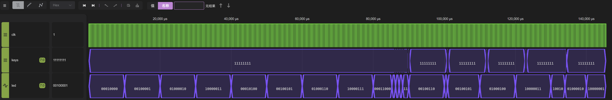
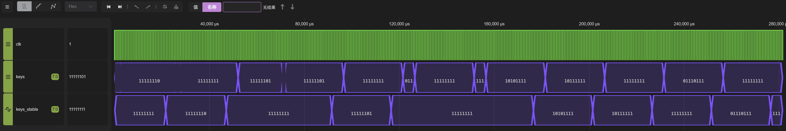
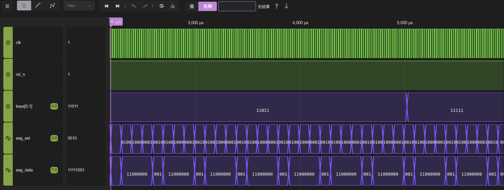

# Lab4 Report

## Task-1

### Modules Design

**1. led.v**

Code:

```verilog
module led #(
    parameter CLK_FREQ = 50_000_000
  )
  (
    input clk,
    input [7:0] keys,
    output [7:0] led
  );

  parameter CLK_1s_MAX = CLK_FREQ - 1;

  wire [7:0] keys_stable;
  KeyDebounce #(
                .CLK_FREQ (CLK_FREQ)
              ) u_keydeb (
                .clk(clk),
                .keys(keys),
                .keys_stable(keys_stable)
              );

  reg [26:0] clk_cnt = 26'b0;
  always @(posedge clk) begin
    if (clk_cnt >= CLK_1s_MAX) begin
      clk_cnt <= 26'b0;
    end
    else begin
      clk_cnt <= clk_cnt + 26'b1;
    end
  end

  wire trigger1s;
  assign trigger1s = (clk_cnt == CLK_1s_MAX) ? 1'b1 : 1'b0;

  reg [3:0] time_state = 4'b0000;
  always @(posedge clk) begin
    if (trigger1s) begin
      time_state <= time_state + 4'b1;
    end
  end

  reg [7:0] keys_pre = 8'b1111_1111;
  always @(posedge clk) begin
    keys_pre <= keys_stable;
  end

  wire [7:0] key_pressed;
  assign key_pressed = keys_pre & ~keys_stable;

  reg [7:0] led_state = 8'b0001_0000;

  reg [7:0] led_nxt1 = 8'b0001_0000;
  always @(*) begin // 1st control: key press
    led_nxt1 = led_state;
    if (key_pressed[0]) led_nxt1[0] = ~led_state[0];
    if (key_pressed[1]) led_nxt1[1] = ~led_state[1];
    if (key_pressed[2]) led_nxt1[2] = ~led_state[2];
    if (key_pressed[3]) led_nxt1[3] = ~led_state[3];
    if (key_pressed[4]) led_nxt1[7:4] = 4'b0001;
    if (key_pressed[5]) led_nxt1[7:4] = 4'b0010;
    if (key_pressed[6]) led_nxt1[7:4] = 4'b0100;
    if (key_pressed[7]) led_nxt1[7:4] = 4'b1000;
  end

  reg [7:0] led_nxt2 = 8'b0001_0000;
  always @(*) begin // 2nd control: time state
    led_nxt2 = led_nxt1;
    if (trigger1s) begin
      led_nxt2[0] = ~led_nxt1[0];
      if ((time_state & 1) == 1) led_nxt2[1] = ~led_nxt1[1];
      if ((time_state & 3) == 3) led_nxt2[2] = ~led_nxt1[2];
      if ((time_state & 7) == 7) led_nxt2[3] = ~led_nxt1[3];
      led_nxt2[7:4] = {led_nxt1[6:4], led_nxt1[7]};
    end
  end

  always @(posedge clk) begin
    led_state <= led_nxt2;
  end

  assign led = led_state;

endmodule
```

Ideas:

首先是计时器模块，根据课件的思路设计。给定时钟频率 `CLK_FREQ` 下计算出 1s 的对应时段数，`clk_cnt` 在每次时序更新的时候加一，到最大值 `CLK_1s_MAX` 后归零。`trigger1s` 在即将要到 1s 的前一帧触发，方便整个时序在真正达到 1s 的时候对应更新相关逻辑。

设计 `time_state` 为 4 位二进制数，表示 0~15 的时间周期状态。`time_state` 用于解决目前的时刻具体初始时刻流逝的时间对应 1、2、4、8 的倍数余数，由于整个循环是 16 为一周期的所以正好使用 4 位二进制数存下来。同样每次时序到 1s 的时候更新 `time_state`，判断是否是倍数的逻辑如下：

```verilog
num = (1 << n) - 1;
if ((time_state & num) == num) led_nxt2[n - 1] = ~led_nxt1[n - 1]; // 触发反转逻辑
```
`time_state` 从 0 开始，如果以 2 为周期，就要在 1s 末、3s 末、5s 末……触发；如果以 4 为周期，就要在 3s 末、7s 末、11s 末……触发；如果是以 8 为周期，就要在 7s 末、15s 末触发。**注意：触发的时候 `time_state` 还在上一时刻未更新。**

对于 `keys` 的处理，经过 KeyDebounce 模块消抖后的 `keys_stable` 出来的是这一当前按键的状态，而题目需要**按下时**触发，因此需要一个变量计算差分：

```verilog
assign key_pressed = keys_pre & ~keys_stable;
```

其中 `keys_pre` 是 `keys_stable` 上一时刻的状态，每次由时序更新。`key_pressed` 产生脉冲的时候一定是上一时刻未按下（值为 1）且此时按下（值为 0），也即**按下时**触发。

最重要的是控制逻辑的设计，由于 `led` 的状态同时由两个逻辑控制：按键和时间。因此不能只用一个时序更新来处理，两个更新逻辑混在一起写非常困难。于是单独放在**两个串联的组合逻辑**中完成：`led_nxt1` 接受上一时刻的稳定 `led_state` 状态并根据按键控制逻辑取反或更新对应状态。`led_nxt2` 承接 `led_nxt1` 并在此基础上再根据时间推进更新状态（流水线或计数跳变），此时 `led_nxt2` 状态是相对上一时刻 `led_state` 的最新的，最后再由时序逻辑控制将 `led_nxt2` 输送回 `led_state`，既保障了不会自己更新自己，也有稳定的锁存器依赖（`led_state`）。

`led_nxt1` 和 `led_nxt2` 是两个串联的组合逻辑，因此使用 `always @(*)` 语块更新。最终回传到 `led_state` 是时序逻辑，因此使用 `always @(posedge clk)` 语块更新。

最后 `led_state` 连线到 `led`。

**2. KeyDebounce.v**

Code:

```verilog
module KeyDebounce #(
    parameter CLK_FREQ = 50_000_000,  // clock frequency(Mhz), 50 MHz
    parameter KEY_CNT = 8
  )
  (
    input                clk,         // clock input
    input  [KEY_CNT-1:0] keys,        // input key pins, raw input
    output [KEY_CNT-1:0] keys_stable  // output stable key status, 0 - press down
  );

  parameter WAITING_20ms_MAX = CLK_FREQ / 50 - 1;

  reg [KEY_CNT-1:0] keys_pre = {KEY_CNT{1'b1}};
  reg [KEY_CNT-1:0] keys_deb = {KEY_CNT{1'b1}};

  reg waiting = 0;
  reg [26:0] clk_cnt = 26'b0;

  wire trigger20ms;
  assign trigger20ms = (clk_cnt == WAITING_20ms_MAX) ? 1'b1 : 1'b0;

  always @(posedge clk) begin
    keys_pre <= keys;
    if (keys != keys_pre) begin
      waiting <= 1;
      clk_cnt <= 0;
    end
    else if (waiting) begin
      if (trigger20ms) begin
        keys_deb <= keys;
        waiting <= 0;
        clk_cnt <= 0;
      end
      else begin
        clk_cnt <= clk_cnt + 1;
      end
    end
  end

  assign keys_stable = keys_deb;

endmodule
```

Ideas:

类似于 `led.v` 中的计时器设计，只是这里的时间从 1s 阈值变到的 20ms，使用 `trigger20ms` 在即将要到 20ms 的前一帧触发，用于指示更新。

按键消抖的处理是在数值稳定后的 20ms 后更新 `keys_deb` 接受 `keys` 作为稳定值。`keys_pre` 记录上一帧的 `keys` 状态，在 `keys` 发生变化时，`waiting` 触发启动（变为 1）并把 `clk_cnt` 清零。在 `waiting` 启动后，只要按键状态维持不变就持续累计 `clk_cnt` 直到 `trigger20ms`（信号已稳定 20ms），此时就可以更新 `keys_deb` 了，同时把 `clk_cnt` 清零，且 `waiting` 取消激活（变为 0），在下一次重新发生变化前，这一段稳定状态不会重复采样更新。

所有寄存器的更新都由时序逻辑控制，因此使用 `always @(posedge clk)` 语块更新。

最后 `keys_deb` 连线到 `keys_stable`。

### Testbench

**1. tb_led.v**

Code:

```verilog
`timescale 1us / 1us

module tb_led;

  reg clk = 1'b0;
  reg [7:0] keys = 8'b1111_1111;
  wire [7:0] led;

  led #(
        .CLK_FREQ(5_000)
      ) uut (
        .clk(clk),
        .keys(keys),
        .led(led)
      );

  always #1 clk = ~clk;

  initial begin
    // Observe automatic blinking and rotation for over 8 seconds
    #85000;

    // Key 0: press with jitter, then release with jitter
    keys[0] = 0;
    #10 keys[0] = 1;
    #10 keys[0] = 0;
    #15 keys[0] = 1;
    #15 keys[0] = 0;
    #500;
    keys[0] = 1;
    #10 keys[0] = 0;
    #10 keys[0] = 1;
    #500;

    // Key 1, 2, 3: toggle corresponding LEDs
    keys[1] = 0;
    #500 keys[1] = 1;
    #500;
    keys[2] = 0;
    #500 keys[2] = 1;
    #500;
    keys[3] = 0;
    #500 keys[3] = 1;
    #500;

    // Key 0: short press (less than debounce delay)
    keys[0] = 0;
    #50 keys[0] = 1;
    #600;

    // Keys 4-7: select LED, then continue rotation
    keys[4] = 0;
    #500 keys[4] = 1;
    #10500;

    keys[5] = 0;
    #500 keys[5] = 1;
    #10500;

    keys[6] = 0;
    #500 keys[6] = 1;
    #10500;

    keys[7] = 0;
    #500 keys[7] = 1;
    #10500;

    // Key 4 and Key 6: multiple key input
    keys[4] = 0;
    #40 keys[6] = 0;
    #700;
    keys[4] = 1;
    keys[6] = 1;
    #11000;

    $finish;
  end

  initial begin
    $dumpfile("tb_Lab4_LED.vcd");
    $dumpvars;
    $display("save to tb_Lab4_LED.vcd");
  end

endmodule
```

Ideas:

通过模拟按键输入和时钟驱动，验证 LED 自动闪烁、流水灯轮转以及按键控制功能，并检查各功能之间的相互影响：

1. LED 自动运行：首先保持所有按键松开，运行超过 8 个模拟秒，测试 LED 0~3 的**不同闪烁周期**和 LED 4~7 的**循环点亮**功能。
2. Key 0 抖动按下：模拟带有**机械抖动**的按键操作，测试消抖模块与 LED 翻转控制逻辑的配合。
3. Key 0 抖动松开：模拟按键**释放过程**中的抖动，测试按键触发事件的检测逻辑。
4. Key 1~3 依次按下：分别操作三个按键，测试各按键与对应 LED 的**独立翻转**控制。
5. Key 0 短按：模拟持续时间**小于消抖阈值**的按键操作，测试消抖功能对 LED 控制的影响。
6. Key 4~7 依次按下：分别选择不同的流水灯位置，测试**按键切换**功能及其与**自动轮转**逻辑的配合。
7. 按键后持续运行：在每次流水灯切换操作后保留一段运行时间，测试按键操作**对原有定时节奏的影响**。
8. Key 4、6 相继按下：模拟多个按键在较短时间内连续操作，测试多键消抖以及 LED 选择逻辑的**优先级处理**。

**2. tb_KeyDebounce.v**

Code:

```verilog
`timescale 1us / 1us

module tb_KeyDebounce;

  reg clk = 1'b0;
  reg [7:0] keys = 8'b1111_1111;
  wire [7:0] keys_stable;

  KeyDebounce #(
                .CLK_FREQ(500_000),
                .KEY_CNT(8)
              ) uut (
                .clk(clk),
                .keys(keys),
                .keys_stable(keys_stable)
              );

  always #1 clk = ~clk;

  initial begin
    // Key 0: press with bouncing
    #1000 keys[0] = 0;
    #100  keys[0] = 1;
    #100  keys[0] = 0;
    #150  keys[0] = 1;
    #150  keys[0] = 0;
    #25000;

    // Key 0: release with bouncing
    keys[0] = 1;
    #100  keys[0] = 0;
    #100  keys[0] = 1;
    #150  keys[0] = 0;
    #150  keys[0] = 1;
    #25000;

    // Key 1: late bouncing resets the 20 ms timer
    keys[1] = 0;
    #19000 keys[1] = 1;
    #500   keys[1] = 0;
    #25000;

    // Key 1: release
    keys[1] = 1;
    #25000;

    // Key 2: short press (less than 20 ms)
    keys[2] = 0;
    #5000 keys[2] = 1;
    #25000;

    // Keys 4 and 6: pressed 5 ms apart
    keys[4] = 0;
    #5000 keys[6] = 0;
    #25000;

    // Release Key 4 and Key 6
    keys[4] = 1;
    #25000;
    keys[6] = 1;
    #25000;

    // Keys 3 and 7: pressed simultaneously
    keys[3] = 0;
    keys[7] = 0;
    #25000;

    // Release simultaneously
    keys[3] = 1;
    keys[7] = 1;
    #25000;

    $finish;
  end

  initial begin
    $dumpfile("KeyDebounce.vcd");
    $dumpvars(0, tb_KeyDebounce);
    $display("save to KeyDebounce.vcd");
  end

endmodule
```

Ideas:

通过改变按键输入电平，模拟实际使用中的按键操作及机械抖动，重点验证连续稳定 20 ms 的消抖逻辑：

1. Key 0 按下抖动：模拟按键按下过程中**多次高低电平切换**，测试消抖计时与状态更新。
2. Key 0 松开抖动：模拟按键释放时的**机械抖动**，测试松开过程的消抖功能。
3. Key 1 延迟抖动：在按下 **19 ms 后**再次改变电平，测试接近计时结束时发生抖动的处理逻辑。
4. Key 1 正常松开：模拟**无抖动**的按键释放，验证基本消抖过程。
5. Key 2 短按：模拟持续 **5 ms 的短暂**按键输入，测试对短时间电平变化的过滤。
6. Key 4、6 相继按下：两个按键**间隔 5 ms** 按下，测试整个按键面板共用计数器时的处理逻辑。
7. Key 4、6 分别松开：测试不同按键依次释放时的消抖处理。
8. Key 3、7 同时按下与松开：测试多个按键同时发生电平变化时的消抖功能。

### Verification results

**1. tb_Lab4_LED.vcd**

Waveform:



Description:

| 测试事件 | 关键时刻 | LED 实际表现 | 检查结果 |
|---|---|---|---|
| LED 初始状态 | 0 μs | `0001_0000` | 正确 |
| LED 0 周期翻转 | 9,999、19,999、29,999 μs 等 | 每 10,000 μs 翻转一次 | 正确 |
| LED 1 周期翻转 | 19,999、39,999 μs 等 | 每 20,000 μs 翻转一次 | 正确 |
| LED 2 周期翻转 | 39,999、79,999 μs | 每 40,000 μs 翻转一次 | 正确 |
| LED 3 周期翻转 | 79,999 μs | 首次翻转，进入点亮状态 | 正确 |
| LED 4~7 循环点亮 | 9,999–79,999 μs | LED 4→5→6→7→4，每 10,000 μs 切换 | 正确 |
| Key 0 抖动按下 | 85,201 μs | 85,203 μs，LED 0 翻转 | 正确 |
| Key 0 松开 | 85,751 μs | LED 不因松开而翻转 | 正确 |
| Key 1 按下 | 86,271 μs | 86,273 μs，LED 1 翻转 | 正确 |
| Key 2 按下 | 87,271 μs | 87,273 μs，LED 2 翻转 | 正确 |
| Key 3 按下 | 88,271 μs | 88,273 μs，LED 3 翻转 | 正确 |
| Key 0 短按 50 μs | 89,070–89,120 μs | 无有效触发，LED 不因短按翻转 | 正确 |
| Key 4 按下 | 89,921 μs | LED 4 已点亮，状态保持 | 符合预期，切换效果未显现 |
| Key 5 按下 | 100,921 μs | 100,923 μs，切换至 LED 5 | 正确 |
| Key 6 按下 | 111,921 μs | LED 6 已点亮，状态保持 | 符合预期，切换效果未显现 |
| Key 7 按下 | 122,921 μs | LED 7 已点亮，状态保持 | 符合预期，切换效果未显现 |
| Key 4、6 相继按下 | 133,921 μs | 133,923 μs，切换至 LED 6 | 正确，Key 6 优先 |
| 按键后的自动定时 | 89,999、99,999、109,999 μs 等 | 自动翻转和流水灯轮转继续 | 正确，计时节奏未重置 |

LED 顶层模块的自动翻转周期、流水灯轮转、按键翻转和按键优先级的测试结果都符合预期，计时推进的功能没有受到按键操作影响。

**2. KeyDebounce.vcd**

Waveform:



Description:

| 测试事件 | 最后一次电平变化 | `keys_stable` 更新时间 | 检查结果 |
|---|---|---|---|
| Key 0 抖动按下 | 1.500 ms | 21.501 ms | 正确，稳定 20 ms 后确认按下 |
| Key 0 抖动松开 | 27.000 ms | 47.001 ms | 正确，稳定 20 ms 后确认松开 |
| Key 1 在 19 ms 后再次抖动 | 71.500 ms | 91.501 ms | 正确，重新计时 20 ms |
| Key 1 松开 | 96.500 ms | 116.501 ms | 正确 |
| Key 2 短按 5 ms | 126.500 ms | 无状态变化 | 正确，短按被过滤 |
| Key 4、6 相继按下 | 156.500 ms | 176.501 ms | 正确，整体重新计时并同时更新 |
| Key 4 松开 | 181.500 ms | 201.501 ms | 正确 |
| Key 6 松开 | 206.500 ms | 226.501 ms | 正确 |
| Key 3、7 同时按下 | 231.500 ms | 251.501 ms | 正确，同时更新 |
| Key 3、7 同时松开 | 256.500 ms | 276.501 ms | 正确，同时更新 |

以上这些测试场景都符合预期。

消抖模块在按键面板最后一次电平变化后，连续等待 20 ms 后的进入稳态才更新，成功过滤了短按输入。


## Task-2

### Modules Design

**1. seg_clock.v**

Code:

```verilog
`timescale 1ns / 1ns

module seg_clock
#(
    parameter CLK_FREQ = 50_000_000 // clock frequency(hz), 50 MHz, T = 1/50 = 0.02 us
) 
(
    input wire                   clk,              // clock input
	input wire                   rst_n,            // asynchronous reset input, low active 
    input wire [5:1]             keys,             // input key pins
    output [3:0]                 seg_sel,          // output digital led chip select
	output [7:0]                 seg_data          // output eight segment digital tube output, MSB is the decimal point
);

// local paramerts
parameter DELAY_1S = CLK_FREQ - 1;

reg [31:0] clk_cnt = 32'b0;
assign trigger1s = (clk_cnt == DELAY_1S);

reg [5:1] keys_prev;
wire [5:1] keys_stable;
wire [5:1] key_press_down;
assign key_press_down = keys_prev & (~keys_stable);

KeyDebounce #(
    .CLK_FREQ(CLK_FREQ),
    .KEY_CNT(5)
) u_key (
    .clk(clk),
    .keys(keys),
    .keys_stable(keys_stable)
);

parameter S_RUN    = 1'b1;
parameter S_STOP   = 1'b0;
reg current_state = S_STOP;
reg next_state = S_STOP;

reg [7:0] clock_mm = 8'd0;
reg [7:0] clock_ss = 8'd0;

reg [3:0] seg_num_0 = 4'd0;
reg [3:0] seg_num_1 = 4'd0;
reg [3:0] seg_num_2 = 4'd0;
reg [3:0] seg_num_3 = 4'd0;


seg_display #(
    .CLK_FREQ(CLK_FREQ)
) u_seg_display (
    .clk(clk),
    .rst_n(rst_n),
    .seg_num_0(seg_num_0),
    .seg_num_1(seg_num_1),
    .seg_num_2(seg_num_2),
    .seg_num_3(seg_num_3),
    .seg_sel(seg_sel),
    .seg_data(seg_data)
);

// timer for scaner counter, driven by clk & reset
always @(posedge clk) begin
    // reset 
    if (rst_n == 1'b0) begin
        clk_cnt <= 32'b0;
    end 
    else if (current_state == S_RUN) begin
        // clk counter
        if (clk_cnt == DELAY_1S) begin
            clk_cnt <= 32'b0;
        end 
        else begin
            clk_cnt <= clk_cnt + 32'b1;
        end
    end 
end

// key_prev, that value from delay 1 clock cycle, driven by clk & reset
always @(posedge clk) begin
    // reset 
    if (rst_n == 1'b0) begin
        keys_prev <= 5'b1_1111;
    end 
    else begin
        keys_prev <= keys_stable;
    end 
end


// 状态机, 1) 状态转移，时序逻辑
always @(posedge clk) begin
    if (rst_n == 1'b0) begin
        current_state <= S_STOP;
    end 
    else begin
        current_state <= next_state;
    end 
end 

// 状态机, 2) 状态切换，组合逻辑
always @(*) begin
    if (current_state == S_STOP && key_press_down[5]) begin
        next_state = S_RUN;
    end 
    else if (current_state == S_RUN && key_press_down[5]) begin
        next_state = S_STOP;
    end 
    else begin
        next_state = current_state;
    end 
end

always @(*) begin
    seg_num_0 = clock_mm / 10;
    seg_num_1 = clock_mm % 10;
end 

always @(*) begin
    seg_num_2 = clock_ss / 10;
    seg_num_3 = clock_ss % 10;
end 

// 状态机, 3) 输出 clock_mm, 时序逻辑
// logic to update clock_mm, driven by clk & reset
always @(posedge clk) begin 
    // reset 
    if (rst_n == 1'b0) begin
        clock_mm <= 8'd0;
    end 
    else if (current_state == S_STOP && key_press_down[3]) begin
        if (clock_mm == 59) clock_mm <= 0;
        else clock_mm <= clock_mm + 1;
    end 
    else if (current_state == S_STOP && key_press_down[4]) begin
        if (clock_mm == 0) clock_mm <= 59;
        else clock_mm <= clock_mm - 1;
    end 
    else if (current_state == S_RUN && trigger1s) begin
        if (clock_ss == 0 && clock_mm > 0) clock_mm <= clock_mm - 1;
    end 
end 

// 状态机, 3) 输出 clock_ss, 时序逻辑
// logic to update clock_ss, driven by clk & reset
always @(posedge clk) begin 
    // reset 
    if (rst_n == 1'b0) begin
        clock_ss <= 8'd0;
    end 
    else if (current_state == S_STOP && key_press_down[1]) begin
        if (clock_ss == 59) clock_ss <= 0;
        else clock_ss <= clock_ss + 1;
    end 
    else if (current_state == S_STOP && key_press_down[2]) begin
        if (clock_ss == 0) clock_ss <= 59;
        else clock_ss <= clock_ss - 1;
    end 
    else if (current_state == S_RUN && trigger1s) begin
        if (!(clock_mm == 0 && clock_ss == 0)) begin
            if (clock_ss == 0) clock_ss <= 59;
            else clock_ss <= clock_ss - 1;
        end
    end 
end  

endmodule
```

Ideas:

`clk_cnt` 通过时序逻辑更新，当前处于 `S_RUN` 时时间才正常流逝，持续累加直到到达 `DELAY_1S`，也就是从 0 开始数的 1s 的 MAX 值，之后置零。`rst_n` 用于控制重置，因此触发时置零计时器。

`keys_prev` 用于存储上一个 `keys_stable`，同样使用时序逻辑更新，`key_press_down` 触发时一定是按钮按下的时候，此功能与 Task-1 中实现的完全一致。`rst_n` 触发时清空上一次记忆（置全 1）。

`current_state` 保存当前的计时状态，时序逻辑更新时读取组合逻辑计算好的 `next_state`，另外 `rst_n` 页控制其进入 `S_STOP` 停止状态。

`next_state` 通过组合逻辑更新，通过当前状态 `current_state` 计算下一状态应该停止计时、开始计时还是保持。

`seg_num_x` 用于填写每个数位的具体数值。`clock_mm` 和 `clock_ss` 都是两位数，使用 `/ 10` 和 `% 10` 的方式读取其十位和个位。

`clock_mm` 的更新由时序逻辑控制，在调时间时（处于 `S_STOP` 状态且 3/4 按键按下）对应加/减对应自己的数字，在 59 和 0 时特判一下用于循环。在 1s 到达时，`clock_mm` 读取一下 `clock_ss` 的值，如果当前状态是 0，那下一状态应该是 59，而自己的分钟位减一（前提是大于 0）

`clock_ss` 的更新由时序逻辑控制，在调时间时（处于 `S_STOP` 状态且 1/2 按键按下）对应加/减对应自己的数字，在 59 和 0 时特判一下用于循环。在 1s 到达时，`clock_ss` 读取一下秒数位和分钟位，如果都是 0，那就不用减一了（到 0 停止了）；如果不是 0，那就减一（0 到 59 循环特判一下）。至于分钟位的更新，不需要秒数位处理。

**2. seg_display.v**

Code:

```verilog
`timescale 1ns / 1ns

module seg_display
#(
    parameter CLK_FREQ = 50_000_000 // clock frequency(hz), 50 MHz, T = 1/50 = 0.02 us
) 
(
    input wire                   clk,              // clock input
	input wire                   rst_n,            // asynchronous reset input, low active 
    input wire [3:0]             seg_num_0,        // display number for segment digital tube #0 
	input wire [3:0]             seg_num_1,        // display number for segment digital tube #1
    input wire [3:0]             seg_num_2,        // display number for segment digital tube #2 
    input wire [3:0]             seg_num_3,        // display number for segment digital tube #3 
    output reg [3:0]             seg_sel = 0,      // digital led chip select
	output reg [7:0]             seg_data = 0      // eight segment digital tube output, MSB is the decimal point
);

// define state code for seg_sel
parameter SEG_SEL_NULL  = 4'b0000 ;
parameter SEG_SEL_0     = 4'b0001 ;
parameter SEG_SEL_1     = 4'b0010 ;
parameter SEG_SEL_2     = 4'b0100 ;
parameter SEG_SEL_3     = 4'b1000 ;

// 计数器, 触发 scan_next 信号
parameter SCAN_CLK_CNT = CLK_FREQ / 1000 - 1;

reg [31:0] clk_cnt = 32'b0;
assign scan_next = (clk_cnt == SCAN_CLK_CNT);

always @(posedge clk) begin
    // reset 
    if (rst_n == 1'b0) begin
        clk_cnt <= 32'b0;
    end 
    else begin
        // clk counter
        if (clk_cnt == SCAN_CLK_CNT) begin
            clk_cnt <= 32'b0;
        end 
        else begin
            clk_cnt <= clk_cnt + 32'b1;
        end
    end 
end


// 状态机 for seg_sel
reg [3:0] next_seg_sel = SEG_SEL_NULL;

// 状态机 for seg_sel, 1) 状态转移，时序逻辑
always @(posedge clk) begin
    if (rst_n == 1'b0) begin
        seg_sel <= SEG_SEL_NULL;
    end 
    else begin
        seg_sel <= next_seg_sel;
    end 
end 

// 状态机 for seg_sel, 2) 状态切换，组合逻辑
always @(*) begin
    if (scan_next) begin
        next_seg_sel = (seg_sel == SEG_SEL_3 || seg_sel == SEG_SEL_NULL) ? SEG_SEL_0 : seg_sel << 1;
    end 
    else begin
        next_seg_sel = seg_sel;
    end 
end

// 状态机 for seg_sel, 3) 输出 sel_num & seg_data
reg [3:0] sel_num = 4'b0;

always @(*) begin
    case (seg_sel)
        SEG_SEL_0: sel_num = seg_num_0;
        SEG_SEL_1: sel_num = seg_num_1;
        SEG_SEL_2: sel_num = seg_num_2;
        SEG_SEL_3: sel_num = seg_num_3;
        default: sel_num = 4'b0000;
    endcase
end

// combination logic, output: seg_data, based on sel_num
always @(*) begin
	case (sel_num)
		4'd0: seg_data = 8'b1100_0000;
		4'd1: seg_data = 8'b1111_1001;
		4'd2: seg_data = 8'b1010_0100;
		4'd3: seg_data = 8'b1011_0000;
		4'd4: seg_data = 8'b1001_1001;
		4'd5: seg_data = 8'b1001_0010;
		4'd6: seg_data = 8'b1000_0010;
		4'd7: seg_data = 8'b1111_1000;
		4'd8: seg_data = 8'b1000_0000;
		4'd9: seg_data = 8'b1001_0000;
		4'ha: seg_data = 8'b1000_1000;
		4'hb: seg_data = 8'b1000_0011;
		4'hc: seg_data = 8'b1100_0110;
		4'hd: seg_data = 8'b1010_0001;
		4'he: seg_data = 8'b1000_0110;
		4'hf: seg_data = 8'b1000_1110;
		default:seg_data = 8'b1100_0000;
	endcase
end

endmodule
```

Ideas:

`clk_cnt` 的设计与 `seg_clock.v` 中保持一致。

为 `seg_sel` 设计状态机，共五种状态：`SEG_SEL_NULL`、`SEG_SEL_0`、`SEG_SEL_1`、`SEG_SEL_2`、`SEG_SEL_3` 分别表示当前应该亮哪一个数码管（或者全不亮）。

`next_seg_sel` 由组合逻辑计算，通过当前 `seg_sel` 计算下一时刻的状态，每 1ms 为周期循环切换数码管。通过如下代码实现：

```verilog
next_seg_sel = (seg_sel == SEG_SEL_3 || seg_sel == SEG_SEL_NULL) ? SEG_SEL_0 : seg_sel << 1;
```

在 `SEG_SEL_NULL` 和 `SEG_SEL_3` 时的下一状态都是 `SEG_SEL_0`，回到第一个。

`seg_sel` 由时序逻辑更新，接受 `next_seg_sel` 计算的值作为下一时刻的状态。

`sel_num` 由 `seg_sel` 的状态决定挑哪一位数字作为显示；`seg_data` 由 `seg_num` 决定具体的数码管数据，填写的是对应数字的数码管操作数据。两者都用组合逻辑更新。

**3. KeyDebounce.v**

已在 Task-1 中详细说明。

### Testbench

Code:

```verilog
`timescale 1us / 1us

module tb_seg_clock;

	// Internal signals
	reg clk = 1'b0;
	reg rst_n = 1'b0;
	reg  [5:1] keys = 5'h1f;
	wire [3:0] seg_sel;
	wire [7:0] seg_data;

	// Instantiate the Unit Under Test (UUT)
	seg_clock #(
		.CLK_FREQ(5000)
	) uut (
		.clk(clk), 
		.rst_n(rst_n),
		.keys(keys),
		.seg_sel(seg_sel),
		.seg_data(seg_data)
	);

	initial begin

	  // Initialize Inputs
	  rst_n = 1'b0;
	  #10;
	  rst_n = 1'b1;
	  #10;

	  // press down, key 3
		keys = 5'b1_1011;
		#5000;
		keys = 5'h1f;
		#5000;

	  // press down, key 5
		keys = 5'h0f;
		#5000;
		keys = 5'h1f;
		#5000;

		#1000000; // 20s
    $finish;
	end
	
	always #10 clk = ~clk;

  // 输出波形文件
  initial begin
    $dumpfile("tb_Lab4_Seg_Clock.vcd");
    $dumpvars;
    $display("save to tb_Lab4_Seg_Clock.vcd");
  end 
      
endmodule
```

Ideas:

通过时钟驱动、复位信号及按键电平变化，验证系统的初始化、时间设置、启动计时、分钟借位以及动态扫描功能。

1. 系统复位：仿真开始时将 `rst_n` 置为**低电平**，再解除复位，测试计数器、状态机和数码管的初始化功能。
2. 数码管动态扫描：持续提供时钟，测试 `seg_sel` 的四位**循环扫描**，以及 `seg_data` 与各数码管显示数字的对应关系。
3. Key 3 设置分钟：模拟 Key 3 按下并保持一段时间后松开，测试分钟加一功能及**消抖**后的单次按键触发。
4. Key 5 启动倒计时：模拟 Key 5 按下与松开，测试状态机**由暂停状态切换至运行状态**。
5. 分钟借位：从设置的 `01:00` 开始倒计时，重点测试秒数为 0 时分钟减一、**秒数更新**为 59 的处理逻辑。
6. 连续倒计时：启动后持续运行，测试秒数周期性递减及数码管显示的同步更新。
7. 长时间运行：保持系统运行至仿真结束，观察计数器、状态机及数码管扫描逻辑的持续工作情况。

### Verification results

Waveform:



Description:

| 测试事件 | 关键时刻 | 实际波形表现 | 检查结果 |
|---|---|---|---|
| 系统复位 | 0～10 μs | `rst_n` 由 0 变为 1，计数器和时间状态初始化为 0 | 正确 |
| 数码管扫描启动 | 90 μs | `seg_sel` 进入 `0001` | 正确 |
| 数码管循环扫描 | 90、190、290、390 μs 等 | `0001 → 0010 → 0100 → 1000` 循环，每 100 μs 切换一次 | 正确 |
| Key 3 按下 | 20 μs | `keys` 从 `11111` 变为 `11011` | 正确 |
| Key 3 消抖 | 2030 μs | `keys_stable` 更新，产生按键触发信号 | 正确 |
| 分钟设置 | 2050 μs | `clock_mm` 从 0 增加到 1，时间变为 `01:00` | 正确 |
| Key 3 松开 | 5020～7030 μs | 松开后完成消抖，分钟保持为 1 | 正确 |
| 数码管译码 | 分钟设置后 | `seg_data` 根据扫描位置输出数字 0、1 对应的段码 | 正确 |
| Key 5 按下 | 10020 μs | `keys` 从 `11111` 变为 `01111` | 正确 |
| Key 5 消抖 | 12030 μs | `keys_stable` 更新，产生按键触发信号 | 正确 |
| 启动倒计时 | 12050 μs | `current_state` 从 `S_STOP` 切换为 `S_RUN` | 正确 |
| Key 5 松开 | 15020～17030 μs | 完成松开消抖，运行状态保持不变 | 正确 |
| 第一次倒计时 | 112050 μs | `01:00 → 00:59`，分钟借位正确 | 正确 |
| 连续倒计时 | 212050、312050、412050 μs | `00:59 → 00:58 → 00:57 → 00:56` | 正确 |
| 后续倒计时 | 512050～1012050 μs | 秒数持续递减，最终到达 `00:50` | 正确 |
| 数码管持续扫描 | 整个运行阶段 | 位选循环正常，段码随分钟、秒数变化更新 | 正确 |

以上这些测试场景都符合预期。状态机与计时逻辑运行正常，数码管能够根据当前时间正确更新和显示。
